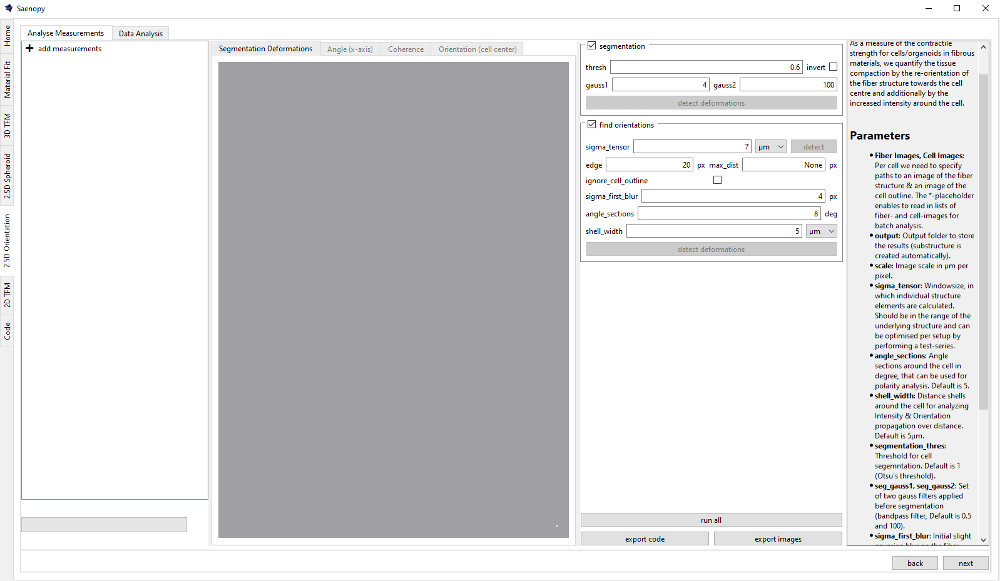
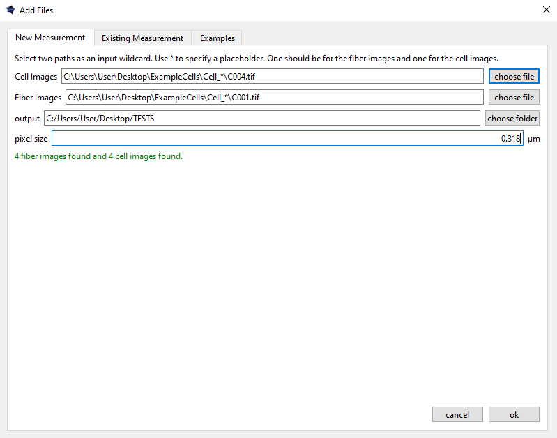

Interface
=========

Calculate the alignment and intensity of matrix fibers directed toward a cell embedded in a 3D biopolymer, based on 2D images. This measurement serves as an indirect proxy for cell contractility.

In the Orientation interface, choose **Relative to Cell**, **Relative to X and Y
Axes** or **Relative to a Point or Line**. The cell workflow keeps the original
contractility analysis. The axis workflow uses the fiber channel for the
structure tensor and can restrict the evaluated region with a mask.
The point workflow measures radial alignment towards a reference selected by
one click. The line workflow uses two clicks to define one reference direction
for the whole image. Select **Point** or **Line** in the import dialog.
The welcome choice disappears after entering the workflow. All choices remain
available whenever adding measurements. The axis workflow offers three choices
side by side in the image dialog:

* **Whole image**: select **Orientation Images** only.
* **Mask from the same image**: select **Orientation Images** only; each image
  also supplies its own mask.
* **Mask from a second image**: select **Orientation Images** and matching
  **Mask Images**. The second image only selects the area; orientation is
  calculated exclusively from the orientation image.

The two masked cases share the mask preview, analysis and result tabs. For a
same-image mask, adjust blur and threshold to select the cell area, rather than
only thin bright fibers. Inspect the preview; this intensity mask does not
automatically separate individual cells. The configured edge crop still applies.
Each measurement retains its own mode. Selecting a measurement updates its
parameters and tabs. The **Angle** tab appears before **Coherency** in every
mode, with an X/Y reference switch; line measurements also offer **Line**.

Adding Measurements
-------------------

Loading a New Measurement
~~~~~~~~~~~~~~~~~~~~~~~~~

Batch searches of image pairs of the matrix structure (fiber images) and the cell outline (cell images) can be performed using placeholder "*" 
to enable open searches across different folders, allowing them to be read in parallel.

Further, the pixelsize and an output directory for results plots and python data files needs to be defined here.

Loading an Existing Measurement
~~~~~~~~~~~~~~~~~~~~~~~~~~~~~~~
Load ``.saenopyOrientation`` files through this tab, or drag files or folders
into Analyse Measurements. To compare their statistics, drag the same evaluated
files into Data Analysis, where they are added to the selected group.
Version 1.0 files remain readable as cell-relative measurements. The newer
files additionally store the axis mode, mask and histogram. Changing the image
labels to Orientation Images and Mask Images does not require a format change.
Keep the image folders with portable result files. The ``.saenopy`` extension
belongs to 3D TFM; do not rename orientation results to that extension.

The Orientation window can be resized down to 900 × 600 pixels. Drag the
dividers to adjust group lists, plots and help. The **Help** button hides or
restores the description, whose colors follow the active Qt theme.

Loading an Example Measurement
~~~~~~~~~~~~~~~~~~~~~~~~~~~~~~
This tab provides example files that can be downloaded to showcase and test various applications of saenopy. Files will
be downloaded to a user directory and directly opened in saenopy.

**Whole image: collagen** (``EmptyCollagen``) contains two empty collagen fields
at 0.249 µm/pixel, analyzed without a mask or artificial cell center.
**Same-image mask: phalloidin** (``FibroblastActin``) contains two fibroblast fields
at 0.48 µm/pixel, analyzed within masks derived from those same images.
For either example, **Open** creates two measurements with preset parameters;
run **find orientations** to calculate them. **Open (evaluated)** opens the two
prepared results directly, including maps and histograms.

**Second-image mask: alpha-actinin** selects cardiomyocytes in a culture with
fibroblasts. Orientation is measured from phalloidin-labeled actin within the
alpha-actinin mask (0.156 µm/pixel). **CellFibers** provides the original
cell-relative collagen example.

The **Spheroid center** and **Cardiomyocyte line** examples show alignment to
a selected point or line. Use **Open (evaluated)** to inspect their results,
or change the reference and run **find orientations** again.

The phalloidin image is used both for fiber analysis and to select stained
regions. This is an intensity mask, not an independent cell-outline stain or
individual-cell segmentation. Inspect the mask preview. The phalloidin package
also includes whole-image controls in ``example_output/whole_image`` for a
comparison through **Existing Measurement**. These paired variants are not
independent biological samples.

Downloaded examples include input images and prepared result files. Keep the
image folders with the results when moving them. Use **Open (evaluated)** or
load the ``.saenopyOrientation`` files through **Existing Measurement**.

Axis measurements
-----------------
For a second-image mask, the image must be registered to the fiber image, with the same dimensions,
position, and z slice or MAX projection. Lists are paired in sorted filename
order; check their pairing before analyzing a batch. The mask retains all
selected regions, without a largest-cell rule. The fiber image is never masked
before the tensor calculation, avoiding artificial orientations at mask edges.

Use **preview mask** to inspect the mask blur and threshold. Changing
the preview does not change an existing analysis; use **find orientations**
again to recompute its validity mask, summary and plots. Cell-specific radial,
sector and shell controls are hidden in axis mode. Old saved measurements load
in cell mode, regardless of the choice for new measurements.

The **Angle** tab has an X/Y reference switch and uses degrees in [-90, 90).
The **Axis alignment** tab has the same switch and a fixed -1 to +1 color scale.
The **Segmentation / mask** tab shows a transparent red fill and outline over
selected regions, including preview masks. These display choices do not alter
the saved angle maps or validity masks.

x is horizontal and y is vertical;
positive x angles slope upwards to the right. The minimum tensor eigenvector
already gives the fiber direction. The alignment tab uses +1 for parallel,
0 at 45 degrees and -1 for perpendicular. x and y alignment are opposite.
Histograms are shown only in Data Analysis. Histograms and per-image means
count each finite selected pixel equally.

The **save plots** and **save NumPy arrays + CSV** checkboxes are independent.
Axis plots include x/y angle overlays and an angle histogram; masked mode adds
side-by-side channels and a mask check. NumPy export includes raw angles and
vectors, coherency, the fiber crop and x/y alignment. Masked mode also saves
``ValidityMask.npy``; its alignment arrays have NaN outside that mask. Raw angle
arrays are unchanged, so apply the validity mask when reading them directly.
``results_axis.csv`` includes unweighted and explicitly named weighted means;
``histogram_axis.csv`` contains bin edges and counts. No cell-distance tables
are generated. The ``.saenopyOrientation`` result is always saved, including
the mode, analyzed mask and statistics. Use separate output folders for modes.

Data Analysis offers **Alignment to X axis**, **Alignment to Y axis**,
**Angular deviation to X axis** and **Angular deviation to Y axis** group plots.
Metrics are greyed out when the checked images and groups do not provide values
for them. Mixed selections can enable both cell-relative and image-axis metrics;
each plot uses only the relevant measurements. Alignment plots keep a fixed
-1 to +1 y-axis in the GUI and exported Python code. Angular deviations range from
0 degrees (parallel to the reference axis) to 90 degrees (perpendicular).
They average absolute axial deviations, not signed angles across the -90/+90 wrap.
Each image contributes one equal-pixel mean, and group means weight images equally.
**Coherency** is available in all measurement modes, with a fixed 0 to 1 axis in
the GUI and exported plots. It averages local directional consistency within
each image's analyzed region, independently of the X/Y or cell-center direction.
A value of 0 is isotropic and 1 is strongly directional within the tensor window;
different regions of an image can still point in different directions.
Masked measurements include only the saved mask. Existing axis results use their
saved coherency maps, so no new orientation calculation is required. Empty or
missing coherency data are excluded rather than treated as zero.
**Angle histogram x/y** first normalizes the histogram of each nonempty image,
then plots group means with SEM across images, expressed as **Probability**.
Each bin is the fraction of valid pixels within that angular interval, between
0 and 1. Each image's bins sum to 1; the plotted y-axis is scaled to the distribution.
These are probabilities per bin, not probability densities per degree.
The CSV fraction column and exported plotting script use the same normalization.
Raw pixel counts are not pooled;
larger images or masks do not receive extra weight. Empty histograms are excluded.
For cell analyses, **mean cell-relative deviation** complements the original
orientation and distance plots. **Export** saves a runnable Python plotting
script with an embedded table or a separate CSV, including grouped histograms.
Cell-relative and axis-relative values are different measurements; unavailable
metrics are left empty, not replaced by zero. Do not treat z slices and their
own MAX projection as independent samples.

Export code reproduces the active measurement's mode and parameter settings.
The original screenshots above illustrate the cell workflow.

Orientation towards a point
--------------------------

Choose **Relative to a Point or Line**, select **Point**, and load an orientation
image. Optionally select a mask from the same image or a second image.
In the **Reference point** tab, click **Choose reference point** and
then click the image. The yellow marker uses original image coordinates
(X to the right, Y downwards). Set a separate reference for each image.
Run **find orientations** to calculate and save the results.

The radial geometry is the same as in the cell-center analysis. Alignment is
+1 radial, 0 at 45 degrees and -1 tangential. The reference pixel itself has no
radial direction and is excluded from point-relative means. The result map marks the
analyzed reference; moving the point in the first tab creates a pending change
until the analysis is run again.

Data Analysis provides **Alignment towards point** and **Angular deviation to
point**, with fixed -1 to +1 and 0 to 90 degree scales. X/Y alignment, angular
deviation, angle histograms and coherency remain available. Exported Python
analysis code includes the selected point.

Set ``shell_width`` to compare alignment, angular deviation and coherency in
concentric rings around the point. **Data Analysis** provides these distance
profiles in pixels or µm, restricted to the selected mask when one is used.

Orientation relative to a line
------------------------------

In the point/line category, select **Line** when adding a measurement. Load
one orientation image, optionally with a mask from the same or a second image,
then click **Choose reference line** in the first tab.
Click two distinct points. The preview follows the cursor after the first
click; Esc, right-click or the button cancels. Zooming and panning preserve
the original pixel coordinates. Each measurement has its own line.

The line defines a fixed axis throughout the image. Its position, length and
endpoint order do not select a region or change the reference direction.
After **find orientations**, the **Angle** and **Alignment (line)** tabs offer
a **Line / X / Y** switch. Alignment is +1 parallel, 0 at 45 degrees and −1
perpendicular. Signed line angles are in [-90, 90); angular deviation uses
their absolute values. Result overlays show the line used in that calculation,
even while a different line is pending in the input tab.

Data Analysis offers **Alignment to reference line**, **Angular deviation to
reference line**, and **Angle histogram: reference line**, alongside X/Y and
coherency. Each image's histogram is normalized to sum to 1 before group means
and SEM are calculated. Both points and the reference angle are saved in
``.saenopyOrientation`` files and included in exported analysis code. Line-angle
maps are derived from the saved X-angle map without an extra stored array.

X/Y statistics for cell measurements
-----------------------------------

Cell-relative measurements also provide X/Y alignment, angular deviation and
angle histograms from the analyzed region outside the cell, respecting the
edge crop and distance limit. Loading an existing result computes these
statistics from its saved maps and segmentation, without rerunning the tensor
or modifying the file. If an older file lacks the cell mask and a saved analysis
region, these extra metrics stay greyed out until that measurement is rerun.
