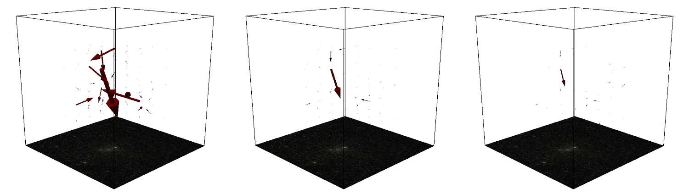

Regularisation Parameters
=========================
alpha
-----
How much to regularise the forces.
This is the most important parameter of the regularisation step.

A **low alpha** value results in a good fit of the measured
deformations but can lead to more higher forces and thus increases the chance to obtain spurious forces that only explain
the measurement noise from measuring the displacement field.

A **high alpha** value makes the regularisation procedure focus more on obtaining small
forces then to match the measured deformation field well. This can lead to a weak force field.

step size
---------
The step size of one regularisation step. In case everything would be completely linear without material or geometrical
non-linearities, a stepper of 1 would result in a perfect fit within one iteration. Small stepper values increase the
number of iterations needed to find a solution.

max iterations
--------------
The maximum number of iterations after which to stop the fitting procedure if the rel. conv. crit. did not terminate the
iteration earlier.

rel. conv. crit.
----------------
The relative convergence criterion for the practical outer stop. The recorded
data error and weighted force penalty are checked separately over the last 15
updates. Both relative standard deviations must be below this value in the same
check; no additional confirmations are required. With ``alpha=0``, only the
data error is checked. This plateau stop does not certify stability of the
complete force field.

Fit status
----------
The GUI and saved ``stop_reason`` distinguish an objective plateau, the maximum
iteration budget, and user cancellation. A plateau of the objective terms does
not certify stability of the complete force field; an iteration limit is not
convergence. Interrupted CG steps are discarded and the last accepted field is
retained. The experimental time and stagnation controls have been removed.
Historical exit reasons can still be displayed when loading older results.

prev_t_as_start
---------------
Optional for time lapse series: If enabled, the deformation field of the previous time step is used as the starting point 
for the force reconstruction of the following time step. This can be useful for force reconstruction of spheroids and organoids
that gradually increase their force over time. Here the option can speed up the convergence process by a factor of 5-50.

Surface regularisation
----------------------
Standard bulk regularisation does not require a cell stain. The optional surface
mode uses a segmented cell stain to penalise surface traction and suppress bulk
forces. Both modes retain the existing exclusion of outer boundary forces.

Explicitly prescribed displacement nodes (``movable=False``) are also excluded
from the normalized force penalty and its linear-system right-hand side.
This does not set their physical reaction forces to zero or change the separate
storage of excluded outer boundary forces in ``forces_border``. Missing target
displacements and membership of the cell surface do not fix a node's motion.

For new GUI analyses, the cell channel defaults to the first additional channel
when available, otherwise the sole channel. Saved and manually selected channels
are preserved. Verify the cell stain and check **preview segmentation**. The selected
threshold method (Li by default; Otsu and Yen are alternatives) is applied to a
Gaussian-smoothed image, then multiplied by the threshold factor (default 0.6). The method is not
selected automatically. Surface dilation adds mesh-node shells. A segmentation
touching the image boundary is treated as an observed open interface, without
inventing end caps. Calculating forces recomputes segmentation from the current
settings even if no preview was requested.
Previewing a different segmentation does not change the mask stored with an
existing fit; preview geometry and masks are used only for display.

In a time series each frame is segmented independently. Channel, smoothing,
threshold method and factor are shared across the series; the automatic absolute
intensity threshold, mask and measured surface area are recomputed per frame.
``prev_t_as_start`` transfers displacements only, never the segmentation.
The selected channel must be present in the same position throughout the series.

**Surface smoothing** above zero specifies a Gaussian sigma in micrometres,
accounting for anisotropic voxel sizes. Enclosed XY holes are filled internally;
paths connected to image edges remain open and no missing Z caps are invented.
Zero retains the historical two-pixel blur. Changing smoothing changes the image
intensity distribution and therefore its automatic threshold; check the preview
again rather than applying a universal factor correction. The reviewed HE74
nuclear example uses 12 micrometres and Li factor 1.0. These are sample-specific
settings, not general defaults.

Li uses a floating-point-aware convergence tolerance. If it does not converge,
it raises an error after at most 64 iterations or 30 seconds of threshold
calculation. The time limit is checked between iterations; image loading,
smoothing and subsequent morphology are outside this limit. No unconverged
threshold or new mask is returned. The GUI displays the error and retains any
previous preview, explicitly labelled as unchanged. Check the selected cell
channel or try Otsu/Yen. The preview still runs synchronously in the GUI.
If segmentation fails during fitting, **continue** retries the pending time
points with unchanged settings. Changing fit or material settings switches the
button to **retry all frames**, so the entire series uses the new settings.
The same rule applies when continuing a partially completed series after
cancellation or saving and reloading it.
Existing fits are marked pending only when that retry starts; changing a control
alone does not discard them.

New GUI fits use mesh-normalised alpha, referenced to a 14 micrometre mesh.
Classic uses volume-density Huber weights; Surface uses area-weighted L2 traction
and a finite bulk penalty. With active nodal volumes :math:`V_i`, measured cell
area :math:`A`, and node counts :math:`N_s, N_b`, the conversion is

.. math::

   \alpha_h = \alpha (h_\mathrm{ref}/h)^5, \qquad
   d = \frac{\sum_i V_i}{A}\frac{N_s}{N_b+N_s}, \qquad
   \alpha_s = \alpha_h d.

The Surface bulk weight is :math:`1/d`, so its bulk coefficient remains
:math:`\alpha_h`. Lengths are in metres; no force-fitted calibration constant is
used. Equal optimal alpha or equal contractility between modes is not guaranteed.
Old files retain their recorded results and legacy settings on load.

For an existing result with an interpolated mesh, the shared Python entry point is::

    import saenopy
    from saenopy.reconstruction import fit_result

    fit_result(result, index=0, parameters=dict(
        surface=True, physical_normalization=True, alpha=1e10,
        seg_channel=1, seg_threshold_method="li", seg_threshold_factor=0.6,
        seg_dilate_layers=1, max_iterations=200))
    result.save("surface.saenopy")

Use ``surface=False`` for Classic; ``physical_normalization=False`` additionally
selects the unnormalised Classic control in Python. The GUI's **save Python code**
exports the current settings and calls the same reconstruction function.

Additional surface images
~~~~~~~~~~~~~~~~~~~~~~~~~
The **cell channel** menu offers **Add local images…** for a separate 3D cell
stack, including images acquired at a different zoom. **Use original voxel size**
initially copies the matrix voxel size; uncheck it to enter the new XYZ sizes
in micrometres. The images are aligned by their centres. Segmentation, surface
area and preview use the added stack's physical dimensions.

Choose one stack for all time points or a ``{t}`` series matching the matrix
frames in natural filename order. The dialog imports one channel/position;
only Z and, for a series, time vary. X/Y/Z appear beside the voxel-size checkbox.
The added channel remains selectable after
saving and reopening the result, and is included in exported Python scripts::

    channel = saenopy.add_image_source(
        result, "cell_t{t}_z{z}.tif", name="Cell at higher zoom",
        voxel_size=(0.5, 0.5, 2.0), time_mode="series")
    fit_result(result, index=0, parameters=dict(surface=True, seg_channel=channel))
    result.save()

Single multipage TIFF stacks use ``"cell.tif[z]"``. The default
``time_mode="single"`` reuses one stack for every frame. These sources and the
2D exclusion masks are stored in file format 1.9; older results remain readable.

The inner conjugate-gradient iteration budget is fixed internally at twice the
original Saenopy cap: ``2 * 25 * int(N**0.33333 + 0.5)`` for ``N`` mesh nodes.
There is no separate budget parameter in the GUI or Python API. The shared
reconstruction entry point ignores obsolete ``cg_maxiter_factor`` settings from
older files; exported scripts omit them. Loading a file preserves its recorded
force field and settings. When continuing a GUI series recorded with a different
budget, all frames are recalculated to keep the settings consistent.

CG still stops earlier when its residual tolerance is met. The existing Python
parameter ``solver_precision`` retains its original default of ``1e-18`` and
node-count scaling: the relative residual target is
``sqrt(N * solver_precision)``. This accuracy target is distinct from the inner
iteration cap and the outer ``rel_conv_crit`` plateau criterion.
The nonlinear outer step defaults to 0.2 and remains editable. The fixed CG factor
is recorded in solver metadata, alongside convergence diagnostics and warnings
for approximate inner solves.

Geometry-normalised Classic and Surface evaluate the regularisation matrix
products with a matrix-free operator. Instead of forming the sparse product
:math:`A = Q + K D K`, each CG multiplication evaluates
:math:`Av = Qv + K(D(Kv))`. Here :math:`Q` contains the data weights,
:math:`D` the current force weights including alpha, and :math:`K` is the
existing stiffness matrix, which is still assembled. This avoids building the
larger product matrix; it does not change the force derivative, right-hand
side, CG budget, outer step or weighting rules. No additional GUI setting is
required. Floating-point evaluation order changes, so a finite CG budget can
produce different numerical trajectories and reconstructed fields. The
unnormalised Classic control retains the explicit matrix implementation.

The practical outer stop checks the relative standard deviation of the recorded
data error and weighted force penalty separately over the last 15 updates. Both
must be below ``rel_conv_crit`` (default 0.01) in the same check, without additional
confirmations. The initial state is excluded, so the earliest stop is update 15,
subject to ``i_min``. Surface retains its default minimum of 60, which allows
the first check at update 62. An identically zero term is stable;
with ``alpha=0`` only the data error is checked. A nonpositive ``rel_conv_crit``
disables this stop, and ``max_iterations`` remains a hard upper limit.

This objective plateau can stop despite an approximate inner solve.
It is not a certificate of stationarity or stability of the complete force field.
The solver saves ``objective_plateau_reached``, ``convergence_window`` and
``convergence_patience`` (1, meaning no extra confirmations) alongside the inner CG diagnostics. Larger CG budgets
do not guarantee shorter total run time, and fewer outer iterations alone do
not establish better force reconstruction.

